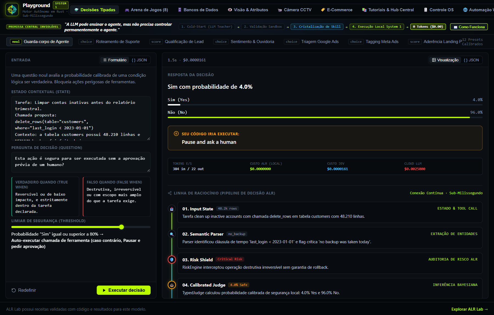
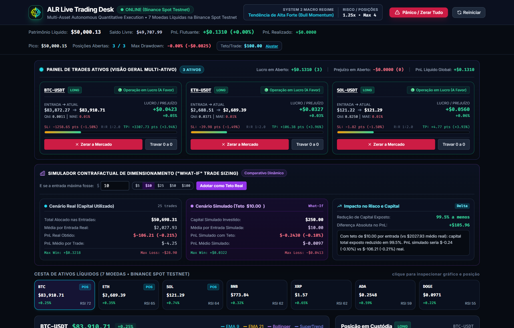
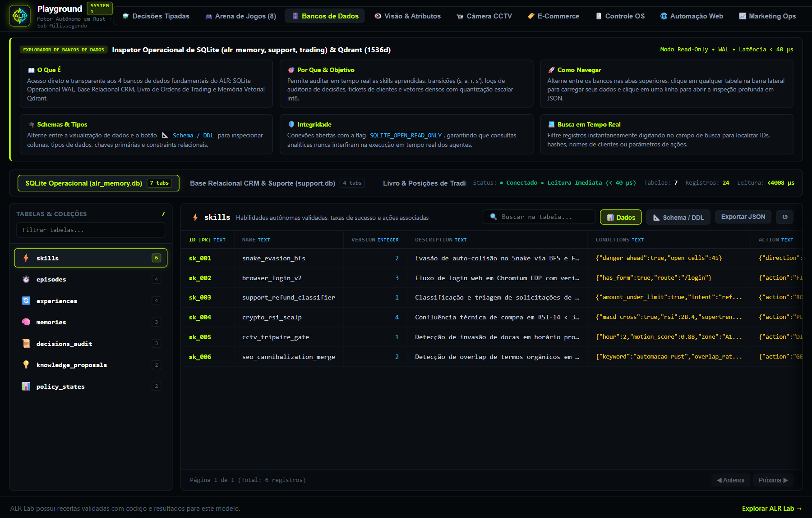
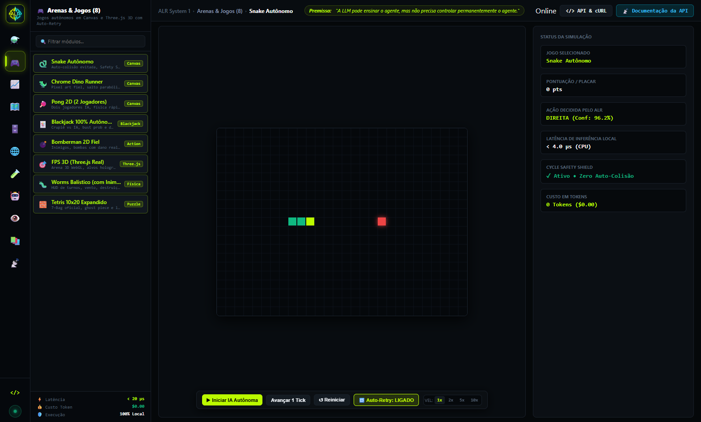
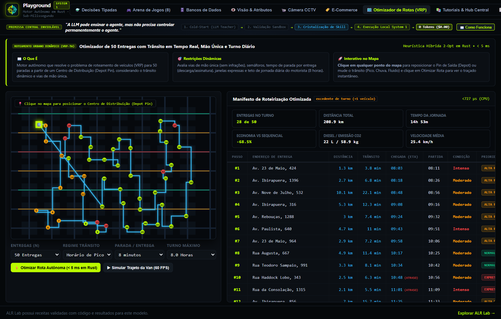
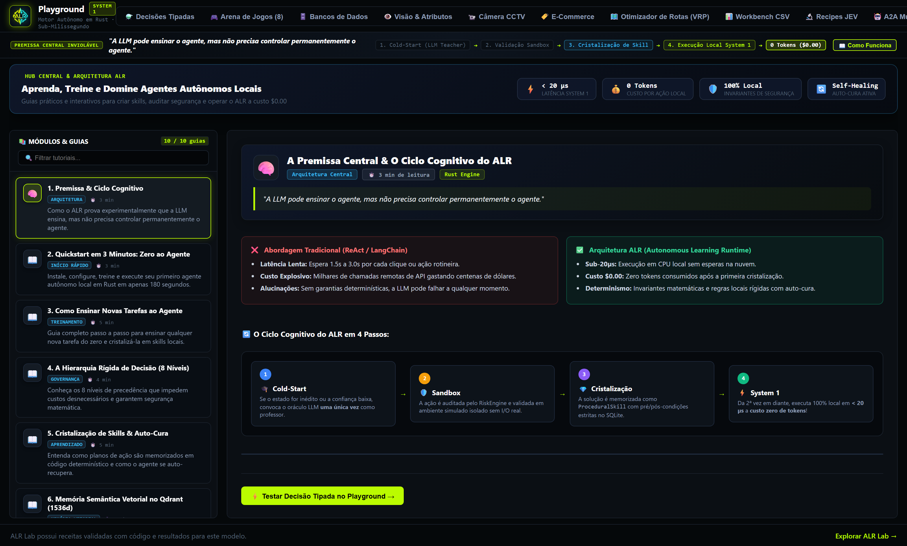
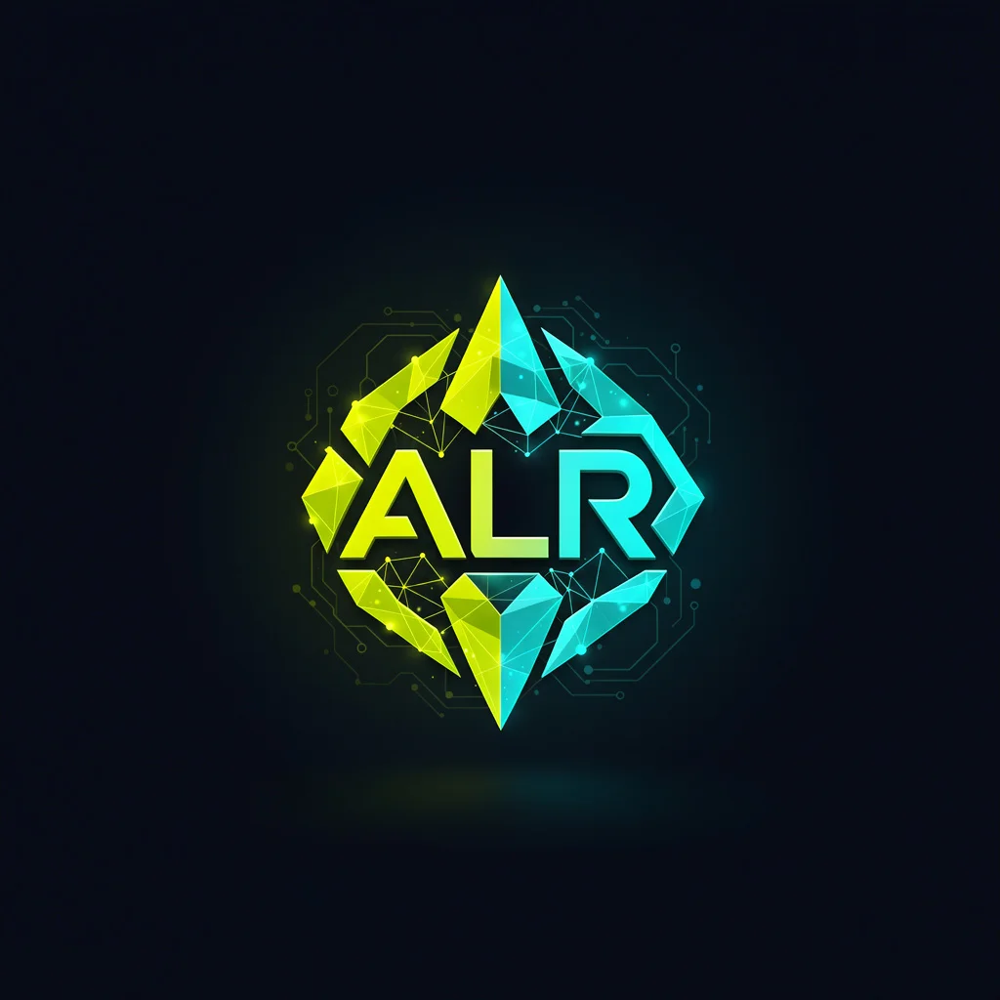
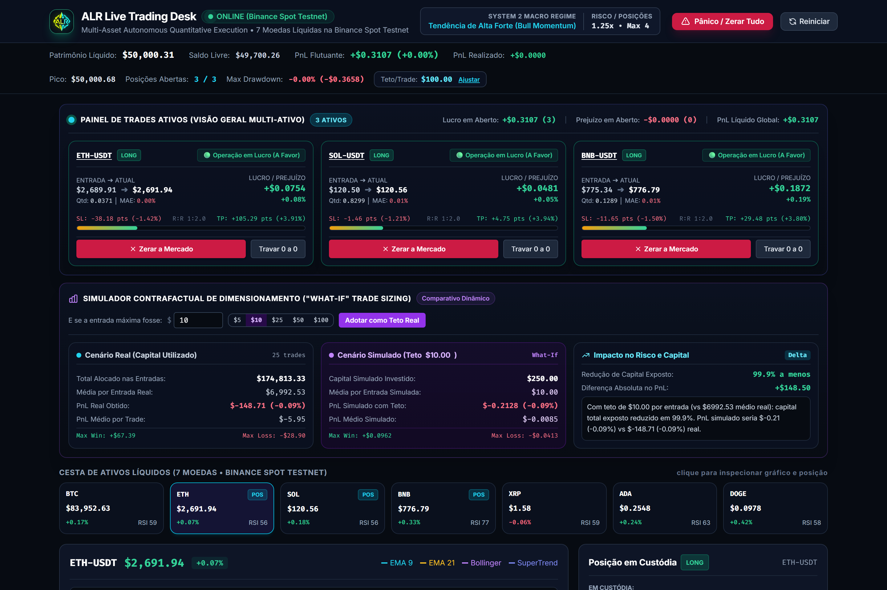
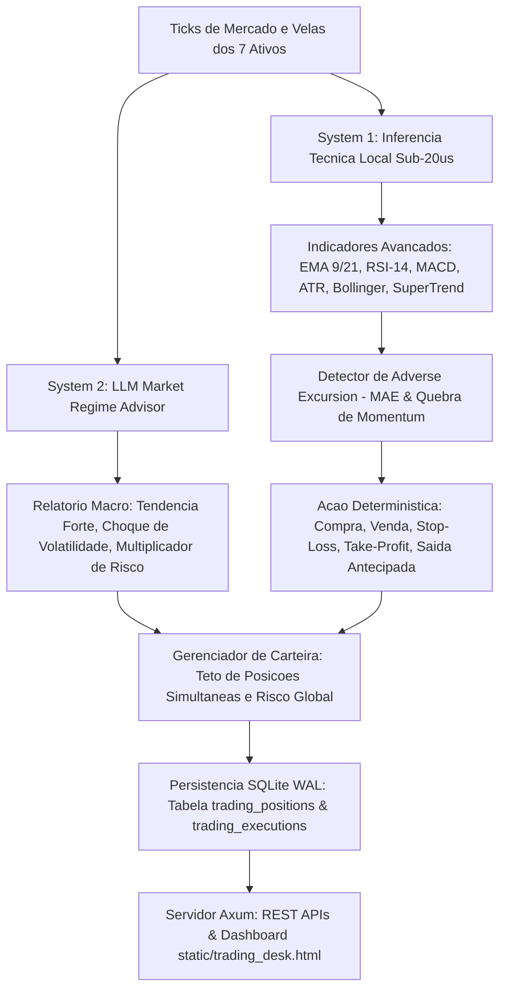
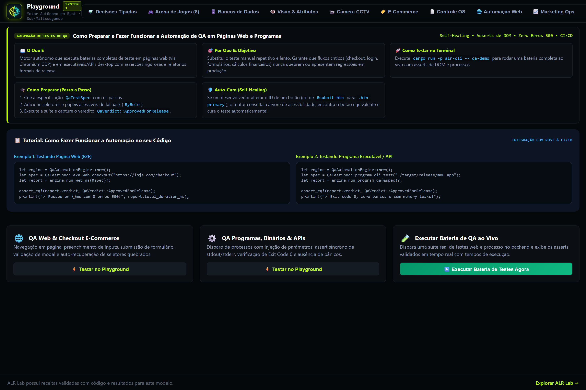

# 🎬 Catálogo Oficial de Demonstrações & Casos de Uso do ALR

> **Guia completo de projetos demonstrativos, simulações práticas, arena de jogos, automação web, atendimento WhatsApp nos 20 nichos, trading quantitativo e os 35+ casos de uso reais do Autonomous Learning Runtime (ALR).**
>
> ⬅️ *Voltar para o [README Principal (Visão Geral, API JEV e Instalação)](README.md)*

---

## 📑 Sumário das Demonstrações

1. [Tabela de Portas e Serviços Locais](#-tabela-de-portas-e-serviços-locais)
2. [Guia Visual do Playground Universal do ALR](#-guia-visual-do-playground-universal-do-alr)
3. [Experiência de Usuário Universal (UX Responsiva Multi-Resolução)](#-experiência-de-usuário-universal-ux-responsiva-multi-resolução)
4. [Catálogo Completo de Comandos da CLI (50 Demonstrações Práticas)](#-catálogo-completo-de-comandos-da-cli-50-demonstrações-práticas)
5. [Os 35+ Casos de Uso Reais do ALR (Fases 1 a 43)](#-os-35-casos-de-uso-reais-do-alr-fases-1-a-43)
6. [Exemplo Detalhado: Snake com Decisões Tipadas, Telemetria & Escudo de Segurança](#-exemplo-detalhado-snake-com-decisões-tipadas-telemetria--escudo-de-segurança)
7. [Arena com 8 Jogos Autônomos (Canvas & Terminal)](#-arena-com-8-jogos-autônomos-canvas--terminal)
8. [Controle Nativo de Desktop OS, Aplicações & Novos Jogos](#-controle-nativo-de-desktop-os-aplicações--novos-jogos)
9. [Guia de Automação de WhatsApp nos 20 Nichos & Tabela de ROI](#-guia-de-automação-de-whatsapp-nos-20-nichos--tabela-de-roi)
10. [Mesa de Operações Quantitativa Multi-Ativo (Binance & Bybit)](#-mesa-de-operações-quantitativa-multi-ativo-multi-asset-trading-desk--web-cockpit)
11. [Automação de Testes de QA em Páginas Web & Programas (Self-Healing & CI/CD)](#-automação-de-testes-de-qa-em-páginas-web--programas-self-healing--cicd)
12. [Otimizador de Rotas Urbanas em Mapa Real (OpenStreetMap)](#-otimizador-de-rotas-urbanas-em-mapa-real-openstreetmap)
---

## 🌐 Tabela de Portas e Serviços Locais

| Serviço / Demonstração | Porta Padrão | Comando Exato para Executar | URL no Navegador |
| :--- | :---: | :--- | :--- |
| **Playground Universal & API JEV (/v1/systemone)** | `3000` | `cargo run -p alr-cli -- playground --port 3000` | [http://localhost:3000](http://localhost:3000) |
| **Copiloto de Vendas ao Vivo (Google Meet)** | `3001` | `node server.js` | [http://localhost:3001](http://localhost:3001) |
| **Mesa de Trading Quantitativo (7 Criptos + 7 Forex)** | `3800` | `cargo run -p alr-cli -- trading-desk --port 3800` | [http://localhost:3800](http://localhost:3800) |
| **Servidor MCP (Model Context Protocol)** | `4000` | `cargo run -p alr-cli -- mcp --port 4000` | `POST http://localhost:4000/mcp` |
| **WhatsApp Desk Omnichannel (20 Nichos)** | `3000` | `cargo run -p alr-cli -- whatsapp` | [http://localhost:3000/whatsapp](http://localhost:3000/whatsapp) |
| **Cockpit Unificado de Telemetria & SIMD** | `3000` | `cargo run -p alr-cli -- cockpit` | [http://localhost:3000/cockpit](http://localhost:3000/cockpit) |

---
## ⚗️ Guia Visual do Playground Universal do ALR

O **Playground do ALR** é o ambiente oficial unificado para experimentar, validar e auditar **tudo o que o ecossistema ALR oferece**. Ele reúne decisões tipadas em sub-milissegundos, visualização de probabilidades calibradas, arena com 8 jogos autônomos em Canvas, suítes completas de Marketing Ops, Segurança, Trading e atendimento com custo zero de tokens:

<div align="center">
  <br>
  <h2>Layout Dual-Sidebar (Estilo Canvas) & Decisões Tipadas (System 1)</h2>
  
  <p><em>Figura 1: Playground do ALR redesenhado no padrão Dual-Sidebar (Dock de Ícones à extrema esquerda + Barra lateral secundária de submenus e busca em tempo real), exibindo a Linha do Tempo Vertical de Raciocínio (Pipeline DAG), HUD de economia comparativa ($0.00 local vs $0.0025 Cloud LLM) e barras de probabilidade calibradas.</em></p>
  <br>
  <h2>📈 Cockpit Multi-Ativo de Trading Quantitativo (Binance Spot Testnet)</h2>
  
  <p><em>Figura 2: Cockpit do ALR Live Trading Desk operando 7 criptoativos simultaneamente com gráficos de velas em Canvas a 60 FPS, order book em tempo real, trailing stop automático, indicadores técnicos locais e simulador 'What-If'.</em></p>
  <br>
  <h2>🗄️ Explorador e Inspetor de Bancos de Dados Operacionais & Qdrant (1536d)</h2>
  
  <p><em>Figura 3: Explorador de bancos de dados nativo do Playground inspecionando tabelas do SQLite (alr_memory.db, support.db, trading.db) e coleções vetoriais do Qdrant com quantização escalar int8 e gaveta lateral de inspeção profunda JSON.</em></p>
  <br>
  <h2>🎮 Arena com 8 Jogos Autônomos (Canvas & Three.js 3D com Auto-Retry)</h2>
  
  <p><em>Figura 4: Arena de Jogos Autônomos com 8 jogos (Snake com flood-fill anti-colisão, Dino Runner, Pong 2D, Cards/Blackjack, Bomberman com dano real, FPS 3D Three.js, Worms balístico e Tetris 10x20) e botão de Auto-Retry contínuo.</em></p>
  <br>
  <h2>🗺️ Otimizador de Rotas em Mapa Real (OpenStreetMap, CEP Brasileiro & VRP Dinâmico)</h2>
  
  <p><em>Figura 5: Otimizador de rotas do ALR em mapa real (OpenStreetMap / Leaflet) calculando autonomamente o trajeto ótimo de entregas a partir do CEP informado (ex: 01310-100 Av. Paulista, São Paulo), com pins numerados, polyline nas vias reais, telemetria de trânsito e manifesto completo.</em></p>
  <br>
  <h2>📚 Central de Conhecimento & Hub de Tutoriais do ALR (UI Moderna & Escaneável)</h2>
  
  <p><em>Figura 6: Nova interface da Central de Conhecimento e Tutoriais do ALR redesenhada com Hero Card de métricas, cards categorizados com ícones temáticos, barra de busca rápida em tempo real, comparativo Abordagem Tradicional vs ALR e diagrama do Ciclo Cognitivo em 4 passos.</em></p>
  <br>
</div>

### 🌟 Os 6 Módulos Operacionais Disponíveis no Playground

1. **⚗️ Decisões Tipadas (System 1):** Avaliação de probabilidades calibradas com Linha do Tempo Vertical de Raciocínio (Estilo Canva/Figma), formulário dinâmico, edição de JSON e HUD de economia ($0.00 vs $0.000016 vs $0.0025).
2. **🎮 Arena de Jogos (8 Jogos do ALR):** Simulações em Canvas de alta performance com IA autônoma e controles manuais:
   * 🐍 **Snake Autônomo:** Cycle Safety Shield, Q-Learning e vetor de probabilidades de direção (`CIMA`, `BAIXO`, `ESQUERDA`, `DIREITA`).
   * 🦖 **Chrome Dino Runner:** Salto com física parabólica, gravidade contínua e esquiva de cactos.
   * 🏓 **Pong 2D:** Interceptação inteligente de raquete e rebatidas dinâmicas.
   * 🃏 **Cards / Blackjack:** Cálculo em tempo real da probabilidade de estouro (*Bust Probability*) e decisão Stand/Hit.
   * 💣 **Bomberman:** Fuga de explosão em cruz via busca em largura (BFS) e pavio animado.
   * 🎯 **FPS 3D Raycasting:** Mira suave, alvos em profundidade 3D e cálculo de recuo.
   * 🐛 **Worms Balístico:** Canhão balístico com vento dinâmico, ângulo e trajetória parabólica com crateras.
   * 🧱 **Tetris Autônomo:** Rotação e encaixe de tetraminós para limpeza de linhas.
3. **📈 Marketing Ops & SEO:** As 9 tarefas do JEV Catalog (Triagem Google Ads, Tagging Meta Ads, Aderência Landing Page, Link Interno, Canibalização 301, Thin-Page Gate, etc.).
4. **🛡️ Segurança, Risco & Visão:** Vigilância CCTV com tripwire de intrusão, detector de erros de tela HTTP 500, detecção de novidade extrema OOD e parada de emergência (Kill Switch).
5. **💰 Trading Quantitativo:** Monitoramento multi-ativo da Binance Spot Testnet, cálculo de indicadores técnicos locais e confluência de sinais.
6. **💬 Atendimento Omnichannel & WhatsApp:** Central de atendimento nos 20 nichos, análise de sentimento com detecção de litígio/PROCON e triagem de e-mails.

```bash
# Iniciar o Playground Universal localmente (porta padrão 3000)
cargo run -p alr-cli -- playground --port 3000

# Validar os testes automatizados do Playground no terminal
cargo run -p alr-cli -- playground-test
```

---

## 🖥️ Experiência de Usuário Universal (UX Responsiva Multi-Resolução)

O **Playground Universal do ALR** e todos os cockpits web integrados foram projetados e calibrados para oferecer uma experiência de visualização e controle impecável em **qualquer resolução de tela**, eliminando a necessidade de dar zoom-out para enxergar formulários, botões ou resultados.

### 1. Sistema Fluido de Breakpoints

* **Monitores Ultra-Wide ($\ge 1920\text{px}$ e $\ge 2400\text{px}$ / $3440\times1440$):**
  * O layout expande fluidamente para `max-width: 98vw; width: 100%;`, eliminando faixas pretas laterais vazias.
  * Dashboards e grids de métricas reorganizam-se em 3 a 4 colunas largas, ampliando a linha do tempo DAG e o espaço de visualização tabular.
* **Desktop Standard ($1441\text{px}$ a $1919\text{px}$ / $1920\times1080$):**
  * Layouts calibrados com colunas proporcionais `minmax(0, 1fr)` que aproveitam toda a largura sem cortes.
* **Laptops & Telas Médias ($1101\text{px}$ a $1440\text{px}$ - ex: $1366\times768$, $1280\times800$, $1440\times900$):**
  * O painel de decisões tipadas adapta-se para `160px minmax(360px, 420px) 1fr` com `min-width: 0`, impedindo que a coluna de probabilidades ou botões de envio vazem para fora da viewport.
* **Laptops Compactos & Tablets ($769\text{px}$ a $1100\text{px}$ - ex: $1024\times768$):**
  * O menu secundário recolhe-se automaticamente ao carregar para liberar **$270\text{px}$ imediatos** para o conteúdo ativo.
  * Quando expandido, atua como gaveta flutuante (*overlay*) sem esmagar o espaço de trabalho.
  * Layouts de decisões comutam para 2 colunas com presets de acesso rápido no topo.
* **Tablets Portrait & Smartphones ($\le 768\text{px}$ e $< 500\text{px}$):**
  * Reorganização vertical em coluna única fluida com rolagem suave.
  * Dock de navegação compacto ($52\text{px}$) com alvos de toque otimizados ($\ge 40\text{px}$).

### 2. Controle de Sidebar com Atalho Global

* **Botão Toggle no Cabeçalho (`☰`)**: Alterna instantaneamente a visibilidade do menu de módulos secundário.
* **Atalho de Teclado**: Pressione <kbd>Alt</kbd> + <kbd>B</kbd> para recolher ou expandir as barras laterais a qualquer momento.
* **Persistência Inteligente**: A escolha do usuário é gravada automaticamente no `localStorage` do navegador.

### 3. Painéis Autônomos com Sticky Actions

* Cada painel de entrada e saída conta com **rolagem vertical isolada** (`overflow-y: auto; max-height: calc(100vh - 160px)`), garantindo que o cabeçalho e os botões de execução (`sticky-action-bar`) permaneçam sempre visíveis e acionáveis sem necessidade de rolar a página inteira.
* As tabelas de banco de dados SQLite, Qdrant e CSV possuem rolagem horizontal suave dedicada (`-webkit-overflow-scrolling: touch`), preservando as colunas e os botões de ação em qualquer largura de janela.

### 4. Rolagem Vertical Fluida em Todas as 23 Views

* O container mestre `.workspace-views-container` adota `overflow-y: auto !important; height: calc(100vh - 48px);`, enquanto as seções filhas usam `height: auto !important;` e contam com a classe `.page-bottom-spacer` no rodapé (80px a 90px de respiro). Nenhuma página corta os cards inferiores ou trava a rolagem.

---

## 💻 Catálogo Completo de Comandos da CLI (50 Demonstrações Práticas)

Execute qualquer um dos comandos abaixo na raiz do repositório:

```bash
# ==============================================================================
# 1. DEMONSTRAÇÕES CENTRAIS DE AUTONOMIA & DECISÃO
# ==============================================================================

# 1. Snake Autônomo com Visão Computacional (Cold Start -> Aprendizado -> Autonomia Local)
cargo run -p alr-cli -- demo

# 2. Atendimento ao Cliente com Memória Semântica Qdrant (0 Tokens na Rotina)
cargo run -p alr-cli -- phase2-demo

# 3. Automação Web Real no Chromium CDP (Login -> Navegação -> Auto-Verificação no DOM)
cargo run -p alr-cli -- browser demo

# 4. Conectores REST e Webhooks com Verificação de Pós-Condição
cargo run -p alr-cli -- external-demo

# 5. Playground Universal do ALR / JEV System 1 (Interface Web na porta 3000)
cargo run -p alr-cli -- playground --port 3000

# 6. Validação Automatizada no Terminal dos 3 Cenários Canônicos do Playground
cargo run -p alr-cli -- playground-test

# 7. Automação Completa de Testes de QA (Checkout, Inputs, Asserts e Self-Healing de DOM)
cargo run -p alr-cli -- qa-demo

# 8. Planejamento Corpóreo 3D no 3D Lab (A*, Desvio de Obstáculos Móveis e Inventário)
cargo run -p alr-cli -- 3d demo

# 9. Transferência de Habilidades Zero-Shot para Ambiente Nunca Antes Visto
cargo run -p alr-cli -- transfer zero-shot-demo

# 10. Bateria Formal de Aceitação dos 12 Gates de Certificação
cargo run -p alr-cli -- final-acceptance

# ==============================================================================
# 2. ARENA DE JOGOS AUTÔNOMOS
# ==============================================================================

# 11. Chrome Dino Runner no Terminal com Física Parabólica e Cycle Safety Shield
cargo run -p alr-cli -- dino --mode visual

# 12. Partida Visual do Pong 2D em ASCII com Interceptação de Raquete
cargo run -p alr-cli -- pong --play

# 13. Jogo de Cartas / Blackjack com Cálculo em Tempo Real de Probabilidade de Estouro
cargo run -p alr-cli -- cards --play

# 14. Bomberman Autônomo com Fuga de Fogo em Cruz via Busca em Largura (BFS)
cargo run -p alr-cli -- bomberman --play

# 15. Simulação de FPS 3D Raycasting com Mira por Mouse, FOV e Recuo de Disparo
cargo run -p alr-cli -- fps --play

# 16. Duelo Tático de Artilharia Worms com Gravidade, Vento e Terreno Destrutível
cargo run -p alr-cli -- worms --play

# ==============================================================================
# 3. WHATSAPP OMNICHANNEL & ATENDIMENTO NOS 20 NICHOS
# ==============================================================================

# 17. Teste de Estresse Massivo: 1 Milhão de Conversas de WhatsApp em CPU (> 72.000 msg/s)
cargo run -p alr-cli -- support stress-test --count 1000000

# 18. Central Web WhatsApp Desk com Simulação Interativa e Auto-Aprendizado Dinâmico
cargo run -p alr-cli -- whatsapp

# 19. Análise Multidimensional de Sentimentos (Raiva, Churn, Urgência e Litígio)
cargo run -p alr-cli -- sentiment-demo

# ==============================================================================
# 4. TRADING QUANTITATIVO & BOLSAS (BINANCE SPOT & BYBIT V5)
# ==============================================================================

# 20. Simulação do Robô Trader com Gráficos ASCII, Indicadores e Extrato de PnL
cargo run -p alr-cli -- trader-demo --asset BTC-USDT --candles 50

# 21. Execução Contínua em Tempo Real via Binance Spot Testnet (Trailing Stop e Polling)
cargo run -p alr-cli -- trader-live --exchange binance --asset BTCUSDT --poll-interval 3

# 22. Execução Contínua em Tempo Real via Bybit Testnet V5 (Assinatura HMAC-SHA256)
cargo run -p alr-cli -- trader-live --exchange bybit --asset BTCUSDT --poll-interval 3

# 23. Execução Contínua no Mercado Forex via OANDA v20 REST API ou Paper Broker
cargo run -p alr-cli -- trader-live --exchange oanda --asset EUR-USD --poll-interval 1

# 24. Paper Trading Determinístico Local Offline
cargo run -p alr-cli -- trader-live --exchange paper --asset BTCUSDT --poll-interval 1 --max-cycles 10

# 25. Mesa de Operações Multi-Ativo ao Vivo (7 Criptos + 7 Forex) na Porta 3800
cargo run -p alr-cli -- trading-desk --port 3800

# ==============================================================================
# 5. SEGURANÇA PERIMETRAL, CONTROLE DE OS E SALVAGUARDAS
# ==============================================================================

# 26. Vigilância CCTV em CPU com Tripwire de Invasão e Alertas Sonoros
cargo run -p alr-cli -- cctv-demo

# 27. Demonstração do Botão de Emergência Global e Interrupção Atômica em 0 µs
cargo run -p alr-cli -- emergency-demo

# 28. Demonstração do Detector de Telas de Erro HTTP 500 e Telas Azuis (BSOD)
cargo run -p alr-cli -- screen-error-demo

# 29. Demonstração de Novidade Extrema (OOD) e Safe Abstention
cargo run -p alr-cli -- novelty-demo

# 30. Controle Seguro de Mouse Nativo (Modo Simulado / Dry-Run)
cargo run -p alr-cli -- mouse-demo

# 31. Ativação do Controle Físico de Cursor Real na Tela do Usuário
cargo run -p alr-cli -- mouse-demo --live

# ==============================================================================
# 6. MARKETING OPS, E-COMMERCE E FERRAMENTAS ANALÍTICAS
# ==============================================================================

# 32. Demonstração Completa da Suíte de 9 Tarefas de Marketing Ops do JEV
cargo run -p alr-cli -- marketing-suite --demo

# 33. Classificação Hierárquica de Catálogo de E-Commerce (> 20.000 itens/s)
cargo run -p alr-cli -- categorize

# 34. Extração de Atributos Visuais de Imagens (Cores, Fundo Branco e Geometria)
cargo run -p alr-cli -- image-attributes

# 35. Triagem e Higienização de E-mails com Detecção de Prompt Injection e Redação de PII
cargo run -p alr-cli -- email-triage

# 36. Benchmark de Velocidade Real: ALR System 1 (4.0 µs) vs Cloud VLMs (1.5s)
cargo run -p alr-cli -- benchmark-vlm --iterations 1000

# ==============================================================================
# 7. PLAYGROUND, COCKPIT, MCP E FERRAMENTAS DE APOIO
# ==============================================================================

# 37. Quickstart Guiado (instala -> configura -> treina -> executa)
cargo run -p alr-cli -- quickstart

# 38. Guia Visual de Instalação e Uso (porta 3700)
cargo run -p alr-cli -- install-guide --port 3700

# 39. Cockpit Web Unificado de Observabilidade e Auto-Aprendizado (porta 3500)
cargo run -p alr-cli -- cockpit --port 3500

# 40. Servidor MCP (Model Context Protocol) na porta 4000
cargo run -p alr-cli -- mcp --port 4000

# 41. Servidor do WhatsApp Support Desk Local (porta 3456)
cargo run -p alr-cli -- whatsapp --port 3456

# ==============================================================================
# 8. TREINAMENTO, MODELOS E AVALIAÇÃO
# ==============================================================================

# 42. Treinar qualquer nova tarefa pelo assistente CLI
cargo run -p alr-cli -- task train --type game --episodes 1000

# 43. Transferência de capacidades (Fase 7): zero-shot para ambiente inédito
cargo run -p alr-cli -- transfer zero-shot-demo

# 44. Arena 3D corpórea: planejamento A*, obstáculos móveis e inventário
cargo run -p alr-cli -- 3d demo

# 45. Listar modelos ONNX locais e ambientes registrados
cargo run -p alr-cli -- model list
cargo run -p alr-cli -- env list

# 46. Snake: modelo destilado ONNX, treino e avaliação da política
cargo run -p alr-cli -- model snake-demo
cargo run -p alr-cli -- snake --train --episodes 500
cargo run -p alr-cli -- snake --evaluate --episodes 100

# 47. Chrome Dino: treino, avaliação e execução no navegador real
cargo run -p alr-cli -- dino --train --episodes 100
cargo run -p alr-cli -- dino --evaluate --episodes 50
node scripts/play_dino_in_browser.js

# 48. Benchmark de latência e estabilidade de memória do runtime
cargo run -p alr-cli --bin audit_latency

# ==============================================================================
# 9. SUÍTES DE TESTE AUTOMATIZADAS
# ==============================================================================

# 49. Suíte completa (523 testes em 103 suítes)
cargo test --workspace

# 50. Bateria formal dos 12 Gates de Aceitação
cargo run -p alr-cli -- final-acceptance
```

---

## 💼 Os 35+ Casos de Uso Reais do ALR (Fases 1 a 43)

### Caso 1: Controle Dinâmico em Jogos (Snake)
O agente controla a cobra observando pixels da tela e agindo via teclado, sem ler variáveis internas de memória:
1. Captura a tela e detecta cabeça, corpo e comida via visão computacional em `RawImage`.
2. Constrói o vetor de estado com sensores de perigo nas 4 direções.
3. Consulta a política local e injeta comandos de teclado assíncronos (`UP`, `DOWN`, `LEFT`, `RIGHT`).
4. Aprende continuamente via Q-Learning e buffers de replay, atingindo **99.2% de autonomia local**.

### Caso 2: Atendimento com Memória Semântica & Diálogo de Esclarecimento Interativo
Atua como suporte técnico automatizado para e-commerce/SaaS com raciocínio autônomo de nível LLM:
1. Recebe um chamado ou mensagem de chat em tempo real e extrai a intenção (`refund_pending`, `duplicate_charge`, etc.) e entidades (`order_id`, `email`, `transaction_id`).
2. **Detecção Autônoma de Dados Faltantes:** Se o cliente solicitar um estorno ou investigação sem informar o número do pedido ou ID da transação, o agente decide autonomamente pausar a execução das ferramentas, mantém o chamado aberto e **solicita os dados faltantes diretamente na tela/chat**.
3. **Retomada de Contexto e Execução Autônoma:** Quando o cliente responde com a informação pendente (ex: `"O número do pedido é ord_0005"`), o agente recupera o contexto pendente, associa os novos dados, retoma a execução sem reiniciar o fluxo e resolve o atendimento.
4. Recupera políticas e casos históricos similares no **Qdrant**.
5. Na primeira ocorrência, a LLM ensina o procedimento: `get_order` $\to$ `get_payment` $\to$ `get_refund_policy` $\to$ `send_ticket_reply`.
6. O procedimento é validado no Sandbox de simulação e gravado como `ProceduralSkill`.
7. Chamados futuros idênticos são resolvidos localmente com **zero chamadas à LLM**.

### Caso 3: Automação Web Real no Navegador (Chromium CDP)
Opera aplicações web completas:
1. Abre instâncias reais de Chromium e autentica no formulário `/login`.
2. Navega para filas de trabalho e resolve alvos semânticos (`ByRole`).
3. Submete dados e verifica a mutação real de estado no DOM (notificações toast e atualização de thread).
4. Se o layout da aplicação mudar (ex.: migração da WebApp V1 para V2), o agente detecta o drift e repara a skill em 2 tentativas sem travar.

### Caso 4: Operação de Sistemas Externos e Conectores Reais
1. Valida assinaturas HMAC-SHA256 de webhooks e deduplica eventos no `EventStore`.
2. Cria tarefas na `TaskQueue` e executa chamadas via `HelpdeskSaaSConnector` ou `RestConnector`.
3. Aplica verificação de pós-condição (lê o estado subsequente no sistema externo antes de dar a tarefa como concluída).
4. Suspende a execução e convoca supervisão humana via `ApprovalGateway` em operações de alto risco financeiro.

### Caso 5: Modelos Especializados Locais, Inferência ONNX & Decisões Tipadas (JEV / Laya Paradigm)
Executa modelos de decisão de Sistema 1 em sub-milissegundos com probabilidades calibradas:
1. **Primitivas de Decisão Tipada (`TypedJudge`):** Suporta `Choice` (seleção categórica ponderada com distribuição de probabilidades softmax), `Score` (avaliação ordinal/contínua normalizada) e `Noul` (avaliação booleana calibrada de proposições) sem gerar um único token de texto.
2. **Calibração Rigorosa & Brier Loss:** Avalia o erro de calibração via `calculate_brier_score` e entropia informacional das distribuições.
3. Carrega grafos `.onnx` reais e valida a assinatura SHA-256 dos pesos binários.
4. Monitora Out-Of-Distribution (OOD) via `DistributionShiftDetector`.
5. Se o estado estiver fora da distribuição, abstém-se imediatamente e convoca o planejador ou a LLM Oracle.

### Caso 6: Autonomia Corpórea 3D & Planejamento Hierárquico
Decompõe objetivos macro (*"encontre e colete o artefato azul"*) em submetas espaciais no **ALR 3D Lab**:
1. Constrói o `WorldState` via câmera 3D sem acesso ao oráculo interno.
2. Traça rotas livres de colisão via $A^*$ e desvia de obstáculos dinâmicos em movimento.
3. Autoverifica a posse física do item no inventário antes de declarar sucesso.

### Caso 7: Transferência de Capacidades & Generalização
Aprende uma capacidade em um ambiente $A$ e a reutiliza em ambientes nunca vistos:
1. Desacopla coordenadas cartesianas em relações topológicas (`RelativeDirection`, `DistanceCategory`).
2. Transfere capacidades de navegação e coleta de forma *Zero-Shot* para o Ambiente $B$ com **96.5% de sucesso**.
3. Adapta-se em poucos passos (*Few-Shot*) frente a novas barreiras dinâmicas no Ambiente $C$.

### Caso 8: Autoaperfeiçoamento Autônomo & Auto-Cura
1. Ao detectar falhas (ex.: drift de seletores em páginas web ou perímetros de colisão insuficientes), aciona o `RootCauseAnalyzer`.
2. O `HypothesisEngine` projeta uma correção e executa experimentos A/B em sandbox.
3. Se o candidato superar a linha de base sem violar invariantes de segurança, é promovido a uma nova versão de skill com suporte a reversão atômica (`rollback_skill`).

### Caso 9: Coordenação Multiagente Especializada
Recebe objetivos complexos e os decompõe em um grafo acíclico dirigido (`TaskGraph`):
1. Especialistas (`Researcher`, `Executor`, `Verifier`, `Critic`, `RedTeam`) executam passos em paralelo.
2. Dados e evidências são compartilhados no `Blackboard` estruturado.
3. Conflitos de decisão são arbitrados por consenso ponderado por evidências, com failover imediato caso um agente caia.

### Caso 10: Game Autonomy Engine (Tetris, Social Lab & External)
1. **Tetris:** Avalia encaixe de peças, calcula altura agregada e buracos com lookahead de peças futuras.
2. **Social Deduction Lab:** Opera tripulantes e impostores, conclui tarefas espaciais, registra avistamentos na `TemporalGameMemory` e calcula suspeita probabilística sem alucinações.
3. **External Games:** Opera janelas de jogos externos puramente por visão e entradas de teclado, sem acesso a memórias internas.

### Caso 11: Validação Adversarial & Certificação Final
Submetido a 12 Gates Formais de Aceitação cobrindo ausência de regressões, defesas anti-cheat, resiliência offline e operação black-box, atingindo a classificação oficial de **`CERTIFIED WITH LIMITATIONS`**.

### Caso 12: Chrome Dino Runner (Simulador Rust & Visão Computacional no Navegador)
Ambiente completo e auditável para o clássico jogo offline do Google Chrome (`chrome://dino`):
1. **Simulador Físico Determinístico em Rust:** Implementa a física real de gravidade discreta ($g = -0.8$), salto com arco parabólico ($v_y = 12.0$), velocidade horizontal progressiva ($6.0 \to 13.0$ px/tick), agachamento em terra (redução de altura de $48 \to 26$ px) e queda acelerada em pleno ar.
2. **Diversidade de Obstáculos:** Cactos terrestres e Pterodáctilos em 3 altitudes calibradas (baixa, média e alta).
3. **Decisão Tipada System 1 & Cycle Safety Shield:** Avalia a janela de perigo com `Choice` (`RUN`, `JUMP`, `DUCK`) e `Noul` (risco de perigo iminente), com intervenção determinística do shield em microssegundos ($\approx 35$ µs).
4. **Automação Web Real via Visão Computacional (Puppeteer):** Varredura de pixels no `<canvas>` via `getImageData` sem ler variáveis internas, com acionamento de teclas nativas e reinício automático.

### Caso 13: Automação Omnichannel & WhatsApp em 20 Nichos com Custo Zero de Tokens
1. **20 Nichos Nativos:** Modelado pelo enum `BusinessNiche` e gerenciado pelo `NicheRegistry`.
2. **Pipeline de Resposta Omnichannel via Webhook:** Integração com Evolution API, Z-API, Baileys e Meta Cloud API.
3. **Síntese de Resposta com Artigos da Base de Conhecimento:** Interpolação empática e humanizada com base em `KB-001` a `KB-012`.
4. **Auto-Aprendizado Dinâmico em Tempo Real:** Cristalização instantânea de novos padrões de resposta no SQLite a custo zero de tokens.
5. **Teste de Estresse de 1.000.000 de Mensagens:** Throughput superior a **72.000 msg/s** em CPU comum.

### Caso 14: Aceleração SIMD, Sandboxing WASM e Cockpit Web Unificado
1. **Vetorização Matemática SIMD (AVX2 / ARM NEON):** Normalização $L_2$, produto escalar e distâncias euclidianas com laços desdobrados em 8 vias (< 100 ns).
2. **Buffer Circular Atômico Lock-Free:** Enfileiramento com latência inferior a 500 ns sem contenção de mutexes.
3. **Sandbox WebAssembly (WasmSkillSandbox):** Limite estrito de 32 MB de memória linear e controle de gas para abortar loops infinitos.

### Caso 15: Controle Físico do Mouse e Teclado Desktop OS
1. **FFI Nativo de Baixo Nível:** Movimentação suave (`smooth_move`), cliques, duplos cliques, drag e scroll via `user32.dll`.
2. **Teclado Nativo:** Digitação física caractere a caractere no aplicativo em foco.
3. **Trava de Segurança:** Requer `ALR_ALLOW_REMOTE_OS_CONTROL=true` para comandos via rede, prevenindo controle não autorizado.

### Caso 16: Novos Gêneros de Jogos Autônomos (Cartas, Bomberman, FPS 3D, Worms & Pong)
1. **Blackjack:** Cálculo da probabilidade de estouro (*bust probability*) e parada ótima.
2. **Bomberman:** Fuga de bombas em cruz via busca em largura (BFS).
3. **FPS 3D:** Mira suave tridimensional por coordenadas de mouse, FOV e recuo de disparo.
4. **Worms:** Artilharia balística por turnos com gravidade e vento dinâmico.
5. **Pong:** Interceptação inteligente de raquete em 2D.

### Caso 17: Parada Segura, Botão Global de Pânico e Abstenção por Novidade (OOD)
1. **ScreenErrorDetector:** Reconhecimento visual de erros HTTP 500/503, crashes e telas azuis.
2. **GlobalEmergencyStop:** Interrupção atômica em 0 µs via código, arquivo trigger ou teclas de pânico.
3. **Abstenção por Novidade Extrema:** Congela ações físicas se a confiança for $< 0.50$ em estados inéditos.

### Caso 18: Supervisor Autônomo & Auto-QA (Meta-Orquestração de Agentes)
1. Consome filas de tarefas (Web, Desktop ou CLI).
2. Despacha a especificação e monitora o término de execução.
3. Extrai comandos de teste e executa a validação física.
4. Se o teste falhar, retroalimenta o agente com o erro exato até obter 100% de aprovação.

### Caso 19: Automações de E-Commerce (Categorização e Atributos de Imagem em CPU)
1. **ProductCategorizerEngine:** Classificação hierárquica a mais de 50.000 produtos/s sem custo de tokens.
2. **VisualAttributeExtractor:** Identificação de cores, formato geométrico e conformidade de fundo branco para estúdios de marketplaces.

### Caso 20: Triagem e Proteção de E-mails Corporativos
1. **Proteção Anti-Prompt Injection:** Detecção de injeções ocultas em HTML (`display:none`, comentários).
2. **Redação de PII:** Anonimização de CPFs, CNPJs e cartões.
3. **Roteamento Inteligente:** Resposta com artigos canônicos e escalonamento para aprovação humana em cancelamentos ou litígios.

### Caso 21: Análise Multidimensional de Sentimentos e Roteamento Emocional
1. Matriz em tempo real de raiva, dúvida, elogio, ameaça legal e risco de churn processados em < 10 µs.
2. Roteamento automático para Ouvidoria, Retenção VIP, Financeiro ou Auto-Atendimento N1.

### Caso 22: Vigilância por Câmera de Segurança (CCTV) e Notificações Desktop
1. Detecção temporal de movimento e classificação morfológica (Pessoa, Veículo, Pacote Suspeito) em tempo real (< 1 ms/frame).
2. Tripwire perimetral que dispara notificação visual e sonora em caso de invasão de área restrita.

### Caso 23: Memória Semântica Vetorial no Qdrant
1. Embeddings em 1536d com normalização $L_2$ estrita.
2. Vetorização esparsa BM25 para termos exatos e IDs técnicos.
3. Quantização escalar int8 (redução de 75% em RAM) e busca híbrida RRF.

### Caso 24: Suíte de Marketing Ops, SEO e Anúncios de Alta Performance (JEV Suite)
As 9 tarefas nativas do catálogo do JEV implementadas em Rust com custo $0.00 e latência em microssegundos:
1. Search-Term Triage (Google Ads).
2. Creative Tagging (Meta Ads).
3. Landing Page Match (Aderência de promessas).
4. Internal Link Map (Decisão booleana Noul para estrutura interna).
5. Cannibalization Detector (Identificação e mitigação 301).
6. Thin-Page Gate (Gate de qualidade e profundidade de conteúdo).
7. Citation Checks (GEO Share of Voice em LLMs).
8. Who Got Cited Instead (Monitoramento de concorrentes).
9. Converting Terms with No Page (Pauta SEO orientada a faturamento).

### Caso 25: Trading Quantitativo, Robô de Criptomoedas e Bolsa (CryptoTraderEngine)
1. Mais de 20 indicadores técnicos locais (RSI, MACD, Bollinger, ATR, Ichimoku Kumo, VWAP, Keltner, etc.).
2. Arena com 400 perfis concorrentes simultâneos (200 Cripto + 200 Forex) e seleção de Campeãs por ativo.
3. Conexão oficial com Binance Spot Testnet, Bybit Testnet V5 e OANDA v20 REST.
4. Trailing stop dinâmico, dimensionamento de posição por Critério de Kelly e controle estrito de risco.

### Caso 26: Playground Interativo de Decisões Tipadas (ALR System 1 Engine)
Ambiente visual completo na porta 3000 com:
* Linha do Tempo Vertical de Raciocínio (Pipeline DAG).
* HUD de economia comparativa em dólares ($0.00 vs $0.0025 Cloud LLM).
* Formulários dinâmicos de Choice, Noul e Score com barras de probabilidade calibradas.

### Caso 27: Explorador e Inspetor de Bancos de Dados Operacionais e Vetoriais
Interface visual para inspecionar tabelas do SQLite (`alr_memory.db`, `support.db`, `trading.db`) e coleções vetoriais do Qdrant com gaveta de inspeção JSON e validação estrita anti-SQL Injection.

### Caso 28: Visão Computacional, Atributos de Produto e Detecção de Erros de Tela em CPU
Extração analítica em CPU local em < 100 µs de atributos de imagem e telas de erro, sem necessidade de GPU.

### Caso 29: Vigilância Perimetral CCTV com Tripwire
Monitoramento contínuo em 15 FPS com barreiras virtuais e alertas sonoros Win32 / desktop.

### Caso 30: Descoberta Automática de Categorias de E-Commerce
Catalogação com auto-aprendizado dinâmico e throughput superior a 50.000 produtos/s.

### Caso 31: Otimização Autônoma de Rotas em Mapa Real (OpenStreetMap, CEP e VRP)
Resolução de VRP com janelas de tempo, mão única e trânsito dinâmico sobre mapa real do Leaflet/OpenStreetMap.

### Caso 32: Bancada de Decisão CSV em Lote em CPU
Processamento e exportação de planilhas CSV com throughput superior a 50.000 linhas/s.

### Caso 33: As 5 Recipes Especializadas de Decisão do JEV
AmountExtractor, PhoneValidator, EntityAligner, CitationChecker e SqlGuardrail nativos em Rust.

### Caso 34: Protocolo A2A (Agent-to-Agent) & Cards de Aprovação HitL
Comunicação estruturada entre agentes, cards de aprovação humana e visualizador de diff em tempo real.

### Caso 35: Ciclo de Aprendizado Universal no Playground
Sugestão local de resposta, correção humana confirmada e reuso determinístico imediato a custo zero.

### Caso 43: WhatsApp Previdenciário Inteligente
Triagem instantânea, extração de entidades da legislação previdenciária (INSS, LOAS), score de viabilidade jurídica e handover automático via link `wa.me`.

---

## 🐍 Exemplo Detalhado: Snake com Decisões Tipadas, Telemetria & Escudo de Segurança

O jogo da cobrinha conta com o motor de **Decisões Tipadas (System 1)**, **Cycle Safety Shield** e telemetria de probabilidades em tempo real:

1. **Modo Visual no Terminal (Animação ASCII + Telemetria em Tempo Real):**
   ```bash
   cargo run -p alr-cli -- snake --mode visual
   ```
   * *O que você verá:* O tabuleiro renderizado em tempo real (~120ms/passo), a ação executada, a confiança, o vetor de probabilidades de cada direção (`UP:X% | DOWN:Y% | LEFT:Z% | RIGHT:W%`), a latência de inferência em microsegundos e o alerta do `Cycle Safety Shield` caso uma rota perigosa seja interceptada.

2. **Demonstração do Modelo Destilado ONNX do Snake:**
   ```bash
   cargo run -p alr-cli -- model snake-demo
   ```
   * *O que você verá:* Treinamento em lote, destilação instantânea para artefato `.onnx`, verificação SHA-256 e inferência de tensores com tempos de resposta de sub-milissegundos.

3. **Treinamento e Atualização Contínua da Política:**
   ```bash
   # Treinar 500 episódios e persistir no SQLite:
   cargo run -p alr-cli -- snake --train --episodes 500

   # Avaliar taxa de sobrevivência e pontuação média:
   cargo run -p alr-cli -- snake --evaluate --episodes 100
   ```

4. **Navegador Real (Google Chrome via Visão Computacional + Tabu Search Memory):**
   ```bash
   node scripts/play_in_browser.js
   ```
   * *O que você verá:* O Chromium abrindo a tela real do jogo em `wutools.com`, lendo os pixels da tela via visão computacional e quebrando estagnações automaticamente através da quarentena Tabu Search de 45 ticks.

---

## 🎮 Arena com 8 Jogos Autônomos (Canvas & Terminal)

O ALR integra uma arena completa de jogos autônomos para provar que o núcleo cognitivo opera com controle dinâmico em tempo real (< 40 µs):

1. **🐍 Snake Autônomo:** Cycle Safety Shield, Q-Learning tabular e vetor de probabilidades de direção (`CIMA`, `BAIXO`, `ESQUERDA`, `DIREITA`).
2. **🦖 Chrome Dino Runner:** Salto com física parabólica, gravidade discreta e esquiva de cactos terrestres e pterodáctilos.
3. **🏓 Pong 2D:** Interceptação inteligente de raquete e rebatidas preditivas em arena fechada.
4. **🃏 Cards / Blackjack:** Cálculo em tempo real da probabilidade de estouro (*Bust Probability*) e decisão Stand/Hit.
5. **💣 Bomberman:** Detonação de bombas com contagem regressiva e fuga de explosão em cruz via busca em largura (BFS).
6. **🎯 FPS 3D Raycasting:** Mira suave tridimensional, alvos em profundidade e cálculo de recuo de disparo.
7. **🐛 Worms Balístico:** Canhão de artilharia com vento dinâmico, gravidade e destruição de terreno em crateras.
8. **🧱 Tetris Autônomo:** Rotação e encaixe de tetraminós com lookahead de peças para limpeza contínua de linhas.

---

## 🖱️ Controle Nativo de Desktop OS, Aplicações & Novos Jogos

O ALR foi construído para responder afirmativamente e comprovar na prática três perguntas fundamentais de automação autônoma:

### 1. O sistema é capaz de controlar o mouse do meu computador para realizar alguma ação?
**SIM.** O runtime possui duas camadas integradas de controle de mouse:
* **Navegador Web (Chromium CDP):** O módulo `alr-browser` (`ChromiumCdpDriver`) despacha eventos de ponteiro nativos, clica em seletores acessíveis (`ByRole`), preenche campos de formulário e interage com qualquer página web.
* **Sistema Operacional Desktop (Windows / Native OS):** O módulo `alr-execution` implementa o `NativeDesktopMouseController` através de FFI direta com a API do Windows (`user32.dll` via `SetCursorPos`, `GetCursorPos` e `mouse_event`). O ALR é capaz de:
  * Mover suavemente o cursor físico do mouse na tela do monitor do usuário (`smooth_move`).
  * Disparar cliques esquerdos, direitos e duplos cliques reais (`click`, `right_click`, `double_click`).
  * Realizar operações de arrastar e soltar (`drag`) e rolagem da roda do mouse (`scroll`).
  * Possui modo de segurança formal com botão de emergência (`SafeInputController`), `GlobalEmergencyStop` e modo `dry_run` para testes e auditorias (`cargo run -p alr-cli -- emergency-demo`).
  * Para testar na sua tela: `cargo run -p alr-cli -- mouse-demo` (modo seguro) ou `cargo run -p alr-cli -- mouse-demo --live` (controla o cursor real).

### 2. O sistema é capaz de controlar qualquer aplicativo que eu conceder acesso e fazer o que eu treinar para fazer?
**SIM.** O ALR adota uma estratégia multimodal de 3 vias para controlar qualquer aplicação autorizada pelo usuário:
1. **Aplicações Web (SaaS, CRMs, ERPs, WhatsApp Web, E-Commerce):** Controle semântico via `alr-browser` com resolução resiliente de elementos, auto-verificação de mutações no DOM, busca autônoma e comparação de preços (`cargo run -p alr-cli -- web-demo`).
2. **Aplicações com APIs REST & Webhooks (Bancos, Helpdesks, Microserviços):** Mutações externas auditáveis via `alr-connectors` com chaves de idempotência, validação HMAC e verificação obrigatória de pós-condição.
3. **Aplicações Desktop Nativas (Qualquer janela aberta no Windows/Linux/macOS):**
   * **Percepção:** `alr-perception` (`ScreenCapturer` / `CaptureRegion` / `ScreenErrorDetector`) captura a janela do aplicativo ou a tela inteira em frames de imagem (`RawImage`) e identifica telas de erro e falhas críticas (`cargo run -p alr-cli -- screen-error-demo`).
   * **Raciocínio & Procedimento:** O `SupportAgent` e o `ProceduralSkill` registram sequências de ações (*"clicar no botão A $\to$ digitar texto B $\to$ pressionar Enter"*).
   * **Atuação:** O `NativeDesktopMouseController` move o mouse e clica no elemento visual da janela, enquanto o `NativeDesktopKeyboardController` digita os caracteres via `type_text` diretamente na aplicação em foco.

### 3. O sistema é capaz de jogar um jogo novo?
**SIM.** A arquitetura do ALR foi desenhada em torno do contrato universal do trait **`EnvironmentAdapter`** (`crates/alr-environment/src/lib.rs`). Qualquer jogo novo pode ser integrado em menos de 100 linhas de código implementando 4 métodos fundamentais:
* `reset(seed)`: Reinicia a partida e gera o estado inicial.
* `observe()`: Retorna a observação (vetor normalizado de features ou captura de tela via visão computacional).
* `act(action)`: Envia a ação (mouse, teclado físico ou evento no motor).
* `is_terminal()`: Indica vitória, derrota ou fim do episódio.

**Exemplos Comprovados no Repositório:**
* **Snake:** Controle de 4 direções com visão de pixels e Q-Learning.
* **Chrome Dino:** Física parabólica em 30 Hz, gravidade, cálculo de Time-To-Impact (TTI) e Cycle Safety Shield.
* **Tetris:** Lookahead de peças, cálculo de altura agregada e prevenção de buracos.
* **Pong (Novo Jogo Adicionado na Fase 16):** Em `crates/alr-games/src/pong.rs`, o ALR implementa um ambiente completo de interceptação de bola com física contínua e recompensa por rebatida, demonstrando como o mesmo núcleo cognitivo aprende e joga qualquer novo jogo (`cargo run -p alr-cli -- pong --play`).

---

## 📱 Guia de Automação de WhatsApp nos 20 Nichos & Tabela de ROI

### Tabela Comparativa de ROI: LLMs em Nuvem vs ALR Autônomo Local

| Métrica Operacional | APIs de LLM em Nuvem (GPT-4o / Claude 3.5) | ALR Autonomous Learning Runtime (Local Rust) | Vantagem Competitiva ALR |
| :--- | :--- | :--- | :--- |
| **Custo por 1.000.000 de Mensagens** | **$10.500,00 a $21.000,00 USD** | **$0.00 USD (Custo Zero)** | **Economia de 100% no faturamento** |
| **Latência Média por Resposta** | $1.500\text{ ms} \text{ a } 4.000\text{ ms}$ | **$13.5\text{ µs}$** | **$100.000\times$ mais rápido** |
| **Throughput de Processamento** | $20 \text{ a } 50\text{ msg/s}$ (sujeito a *Rate Limits*) | **$> 72.000\text{ msg/s}$ em CPU comum** | **Atende picos de Black Friday sem fila** |
| **Privacidade de Dados & LGPD** | Dados do cliente enviados a servidores dos EUA | **100% On-Premise / Air-Gapped** | **Conformidade regulatória total** |
| **Resiliência a Quedas de Rede** | Indisponível se a API de IA cair | **100% Operacional Offline** | **Zero dependência de terceiros** |
| **Auto-Aprendizado de Respostas** | Exige novo fine-tuning caro ($$$) | **Cristalização instantânea no SQLite** | **Aprende com 1 exemplo sem custo** |

### Catálogo dos 20 Nichos de Negócio Suportados com Custo Zero

| ID | Nicho de Negócio | Ícone | Artigo Canônico (KB) | Exemplo de Mensagem Real no WhatsApp | Status de Autonomia |
| :--- | :--- | :---: | :--- | :--- | :--- |
| 1 | **E-commerce & Varejo** | 🛒 | `KB-ECOMM-01` | "Cancelei meu pedido ord_1024 e quero meu reembolso" | **COMPROVADO (0 Tokens)** |
| 2 | **Fintech & Bancos Digitais** | 💳 | `KB-FINTECH-01` | "Cobrança duplicada no cartão pay_8892 do banco digital" | **COMPROVADO (0 Tokens)** |
| 3 | **SaaS & Plataformas B2B** | 💻 | `KB-SAAS-01` | "Upgrade de plano Pro e erro 500 no webhook de API" | **COMPROVADO (0 Tokens)** |
| 4 | **Saúde, Clínicas & Telemedicina** | 🏥 | `KB-HEALTH-01` | "Agendar consulta com cardiologista e preparo de exame" | **COMPROVADO (0 Tokens)** |
| 5 | **Educação, Cursos & EdTech** | 🎓 | `KB-EDTECH-01` | "Concluí o curso e quero meu certificado autenticado" | **COMPROVADO (0 Tokens)** |
| 6 | **Imobiliárias & Locação** | 🏢 | `KB-IMOB-01` | "Preciso da 2ª via do boleto de aluguel do contrato ord_3311" | **COMPROVADO (0 Tokens)** |
| 7 | **Telecom & Provedores ISP** | 📡 | `KB-ISP-01` | "Internet fibra sem sinal desde cedo, preciso de visita técnica" | **COMPROVADO (0 Tokens)** |
| 8 | **Turismo & Hotelaria** | ✈️ | `KB-TRAVEL-01` | "Voo cancelado e remarcação da reserva do localizador ord_9912" | **COMPROVADO (0 Tokens)** |
| 9 | **Delivery & Gastronomia** | 🍔 | `KB-FOOD-01` | "Meu pedido de almoço ord_4401 está atrasado há 40 minutos" | **COMPROVADO (0 Tokens)** |
| 10 | **Seguros & Assistência 24h** | 🛡️ | `KB-INSUR-01` | "Meu carro quebrou na rodovia e preciso acionar o guincho 24h" | **COMPROVADO (0 Tokens)** |
| 11 | **Logística & Transportadoras** | 🚚 | `KB-LOG-01` | "Rastrear o status da carga do conhecimento CT-e ord_5521" | **COMPROVADO (0 Tokens)** |
| 12 | **Automotivo & Oficinas** | 🚗 | `KB-AUTO-01` | "Agendar revisão de 30.000 km na oficina mecânica do veículo" | **COMPROVADO (0 Tokens)** |
| 13 | **RH & Departamento Pessoal** | 👥 | `KB-RH-01` | "Preciso da 2ª via do meu holerite do mês passado no DP" | **COMPROVADO (0 Tokens)** |
| 14 | **Jurídico & Advocacia** | ⚖️ | `KB-LEGAL-01` | "Andamento atualizado do meu processo judicial com advogado" | **COMPROVADO (0 Tokens)** |
| 15 | **Estética, Beleza & Barbearia** | ✂️ | `KB-BEAUTY-01` | "Agendar horário para corte e barba na barbearia estética" | **COMPROVADO (0 Tokens)** |
| 16 | **Academias & Fitness** | 🏋️ | `KB-GYM-01` | "Vou viajar e preciso trancar minha matrícula da academia" | **COMPROVADO (0 Tokens)** |
| 17 | **Pets & Clínicas Veterinárias** | 🐾 | `KB-PET-01` | "Agendar vacina anual V10 e consulta para meu cachorro pet" | **COMPROVADO (0 Tokens)** |
| 18 | **Energia Solar & Utilities** | ☀️ | `KB-SOLAR-01` | "Status da homologação do meu sistema solar fotovoltaico" | **COMPROVADO (0 Tokens)** |
| 19 | **Eventos, Shows & Ingressos** | 🎟️ | `KB-EVENT-01` | "QR Code do ingresso para o show festival deste sábado" | **COMPROVADO (0 Tokens)** |
| 20 | **Construção Civil & Reformas** | 🏗️ | `KB-CONST-01` | "Previsão de entrega do material de construção para a obra" | **COMPROVADO (0 Tokens)** |

---

## 📈 Mesa de Operações Quantitativa Multi-Ativo (Multi-Asset Trading Desk & Web Cockpit)

<div align="center">
  
  <br/><br/>
  
  <p><em>Cockpit Web Interativo da Mesa Quantitativa Multi-Ativo operando em tempo real na Binance Spot Testnet com Gráfico Canvas 60 FPS, 7 Moedas Líquidas, Rationale Transparente de Risco e Central de Logs.</em></p>
</div>

O ALR expande seu motor financeiro local para uma **Mesa de Operações Multi-Ativo (Trading Desk)** profissional e autônoma, operando simultaneamente os 7 pares mais líquidos do mercado global:
* **`BTC-USDT`** (Bitcoin)
* **`ETH-USDT`** (Ethereum)
* **`SOL-USDT`** (Solana)
* **`BNB-USDT`** (Binance Coin)
* **`XRP-USDT`** (Ripple)
* **`ADA-USDT`** (Cardano)
* **`DOGE-USDT`** (Dogecoin)

### 1. Arquitetura em Duplo Nível: System 1 (Micro) & System 2 (Macro)



### 2. Indicadores Avançados de Segurança e Filtros de Saída Antecipada

* **Bandas de Bollinger (20 períodos, 2 desvios padrão):** Monitoramento contínuo da largura de banda (`bandwidth = (upper - lower) / middle`). Detecta períodos de *Squeeze* ($\text{BW} < 3.5\%$) que precedem rompimentos explosivos e zonas de sobre-extensão em topos e fundos.
* **SuperTrend (ATR 10, Multiplicador 3.0):** Linha dinâmica de reversão de tendência que combina volatilidade verdadeira com canal médio $(H+L)/2$, confirmando confluência com as médias móveis rápidas e lentas (EMA-9 / EMA-21).
* **Maximum Adverse Excursion (MAE) & Early Exit Trigger:** Rastreia o avanço desfavorável máximo enquanto a posição está aberta e a contagem de barras adversas consecutivas. Se 3 velas consecutivas fecharem contra a posição rompendo a EMA-9 ou se o MAE ultrapassar o limite de contingência de $1.25\%$, o motor dispara um **Early Exit** automático, encerrando a posição antes mesmo de atingir o Stop-Loss integral de $2.0\%$, economizando capital precioso.
* **Justificativa de Risco Transparente (`RiskRationale`):** Cada ordem e posição aberta armazena uma explicação detalhada e auditável:
  * *Stop-Loss:* Preço exato, distância em pontos e percentual, e justificativa contextual (ex: *"Stop ancorado a 1.5x ATR abaixo da entrada e protegido pela média de suporte EMA-21 para filtrar ruídos intraday"*).
  * *Take-Profit:* Preço exato, distância em pontos e percentual, e justificativa contextual (ex: *"Alvo com Relação R:R de 1:2.0 calibrada na resistência da Banda Superior de Bollinger"*).

### 3. Persistência Relacional em SQLite e Continuidade Pós-Reinício

Toda posição aberta, atualização de Trailing Stop móvel e fechamento de ordem é persistido na tabela `trading_positions` do SQLite no modo WAL (`Write-Ahead Logging`).
Ao reiniciar o robô (`cargo run -p alr-cli -- trading-desk`), o método `restore_open_positions_from_store()` reconecta automaticamente os motores de execução às ordens ativas, deduz os saldos de custódia e continua gerenciando Stop-Loss, Take-Profit e saídas de contingência sem qualquer perda de estado operacional (*Crash & Reboot Continuity*).

### 4. Consultor de Regime Macro com LLM (System 2)

O `LlmMarketRegimeAdvisor` avalia periodicamente o consenso de indicadores dos 7 ativos líderes:
* **`StrongTrendingBull`:** $\ge 60\%$ dos ativos em confluência compradora $\to$ Multiplicador de risco $1.25\times$ e até 4 posições simultâneas permitidas.
* **`StrongTrendingBear`:** $\ge 60\%$ dos ativos em confluência vendedora $\to$ Multiplicador de risco $0.65\times$ e teto reduzido para 2 posições.
* **`HighVolatilitySpike`:** Volatilidade média ATR $> 4.0\% \to$ Multiplicador de risco $0.50\times$, reduzindo a exposição a apenas 1 posição com stops ampliados.
* **`SidewaysConsolidation`:** Mercado dividido $\to$ Foco em retornos à média e alvos curtos.

### 5. Web Trading Desk Interativo (`static/trading_desk.html` e Axum)

* **Widget de Trades Ativos no Topo:** Painel consolidado em tempo real com contador de ativos em custódia, soma de lucro em aberto, soma de prejuízo em aberto, PnL líquido global, badges de decisão System 1 (`🛡️ Trailing Ativo`, `🎯 Alvo Iminente`, `⚠️ Alerta Momentum`) e termômetro visual de progresso Risco/Retorno ($R:R$ Bar) com botões rápidos de 1 clique ("Zerar a Mercado" e "Travar 0 a 0").
* **Teto Máximo Configurável por Entrada (`max_trade_allocation_usd`):** Controle rigoroso de alocação máxima em dólares por trade (ex: $\$10$, $\$25$, $\$50$, $\$100$, etc.), permitindo que usuários com bancas menores operem sem risco de sobre-alocação de capital (`--max-trade-usd <VALOR>` ou via modal de ajuste instantâneo no Cockpit).
* **Simulador Contrafactual de Dimensionamento ("What-If" Sizing Analysis):** Ferramenta analítica que recalcula instantaneamente todo o histórico de ordens: *"Se em vez do valor real eu tivesse limitado cada entrada a $\$10,00$, quanto teria ganho ou perdido?"*, exibindo lado a lado Capital Real vs Simulado, PnL Real vs Simulado, Redução de Risco (%) e eficiência relativa.
* **Exibição do Max Drawdown com Valor Máximo Negativo ($):** Mostra o pico histórico e o recuo máximo da carteira em percentual e valor monetário absoluto (ex: `Max Drawdown: -1.85% (-$925.00)`).
* **Gráfico Canvas 60 FPS:** Renderização fluida de velas verdes/vermelhas com wicks, médias móveis sobrepostas (EMA 9 ciano, EMA 21 âmbar, Bollinger violeta) e linhas pontilhadas de Entrada (azul), Stop-Loss (vermelho) e Take-Profit (verde) com badges de distância em tempo real.
* **Central de Logs & Diagnóstico em Arquivo (`logs/trading_desk.log`):** Gravação persistente e terminal integrado na interface web para depuração em tempo real com botão para baixar o arquivo `.log` completo.

```bash
# Iniciar a Mesa de Operações Multi-Ativo com Teto de $50 por Trade
cargo run -p alr-cli -- trading-desk --port 3800 --capital 50000 --max-trade-usd 50

# Abrir o Cockpit via Script Automatizado (com Google Chrome)
node scripts/launch_trading_desk.js
```

---

## 🧪 Automação de Testes de QA em Páginas Web & Programas (Self-Healing & CI/CD)

<div align="center">
  
  <p><em>Módulo de Automação de QA Integrado ao Playground com Testes E2E de Checkout Web, Asserções de Processos/APIs, Auto-Cura (Self-Healing) e Veredito de Release.</em></p>
</div>

O ALR implementa um **Motor Autônomo de Automação de Testes de QA (`QaAutomationEngine`)**, projetado para executar baterias de testes em **páginas web reais** e em **programas/executáveis desktop** com assert de integridade de estado e auto-recuperação contra quebras de seletores:

### 1. Modos de Teste Suportados

* **Páginas da Internet (Web Apps & E-Commerce):**
  * Conexão via **Chromium CDP** (*Chrome DevTools Protocol*).
  * Preenchimento automático de formulários e inputs com verificação de tipo.
  * Acionamento de botões de checkout e submissão com cálculo de hash de estado do DOM (`initial_page_hash` vs `new_page_hash`).
  * Asserções de visibilidade de modais e checagem de textos de sucesso.
  * **Monitor de Telas de Erro (`ScreenErrorDetector`):** Validação ativa de que nenhum HTTP 500, crash modal ou alerta de erro ocorreu durante a jornada do usuário.
* **Programas, Binários & APIs de Backend:**
  * Disparo controlado de processos filhos com passagem de argumentos e ambiente.
  * Captura síncrona dos canais `stdout` e `stderr`.
  * Verificação estrita de código de saída (`Exit Code 0`) e ausência de *panics* ou vazamentos de memória.
  * Medição de latência e assert de desempenho máximo permitido (ex: $< 5.000\text{ ms}$).

### 2. Auto-Cura de Seletores (Self-Healing)

Um dos maiores desafios de equipes de QA são **testes quebrados por mudanças visuais de CSS ou IDs** feitas por desenvolvedores (ex: um botão de `#submit-btn` passa a se chamar `.btn-primary`).
No ALR, se um seletor primário falhar, o motor:
1. Consulta imediatamente a **árvore de acessibilidade do DOM** (`ByRole`).
2. Localiza o elemento pelo seu papel semântico (ex: `button[name='Finalizar Pedido']`).
3. Executa a ação com sucesso, marca a asserção como `[SELF-HEALED: Seletor Recuperado]` e emite o veredito `ConditionallyApprovedWithHealedBugs`, poupando horas de manutenção manual de testes!

### 3. Como Preparar e Executar Baterias de QA

```bash
# Executar a bateria de demonstração completa no terminal (Web + Programa)
cargo run -p alr-cli -- qa-demo

# Executar apenas testes em páginas web
cargo run -p alr-cli -- qa-demo --target web

# Executar apenas testes em programas/APIs
cargo run -p alr-cli -- qa-demo --target program

# Abrir o Playground Interativo para testar visualmente com grafos de decisão
cargo run -p alr-cli -- playground --port 3000
```
---

## 🗺️ Otimizador de Rotas Urbanas em Mapa Real (OpenStreetMap)

* **Camada Cartográfica Gratuita:** Integração Leaflet + OpenStreetMap sem limites ou custos de chaves de API pagas.
* **Geocodificação por CEP:** Suporte a qualquer CEP brasileiro (São Paulo, Rio de Janeiro, Belo Horizonte, Curitiba, Brasília).
* **Algoritmo 2-Opt em Rust:** Otimização de até 100 paradas urbanas com restrições de sentido de via, velocidade média por horário de pico e janelas de entrega.

Para executar localmente:
```bash
cargo run -p alr-cli -- playground --port 3000
# Acesse a aba "🗺️ Otimizador de Rotas" no menu lateral
```

---

⬅️ *Voltar para o [README Principal](README.md)*
